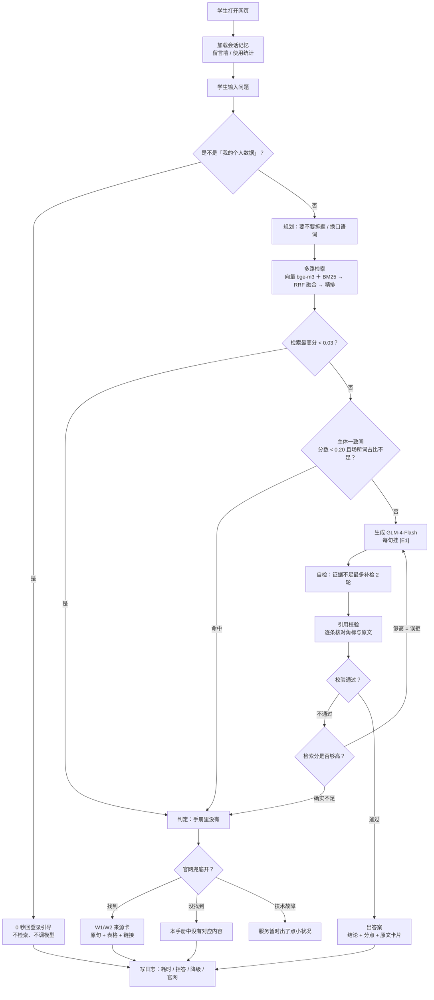
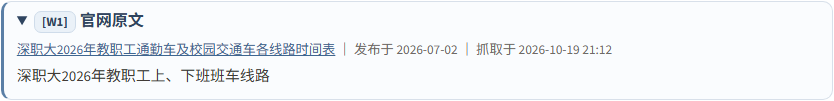
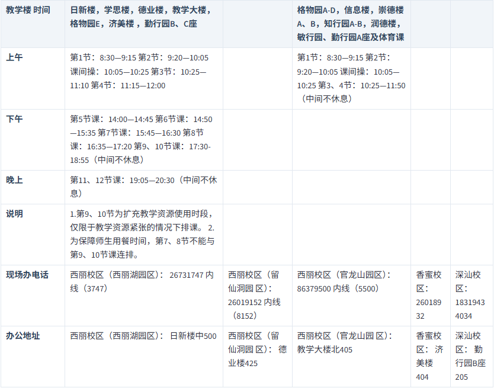

# 深圳职业技术大学《学生手册》智能问答

> 学生用大白话问一句（「挂科了怎么办」「宿舍能用吹风机吗」「班车怎么坐」），
> 系统**只依据《学生手册（2025 年修订）》原文**作答，每条结论都能点回它引用的那一条；
> 手册里没写的，先说「本手册中没有对应内容」，再去**学校官网**找一圈，
> 找到就照抄原文、单独标来源，找不到就老实说没有。

| 项 | 内容 |
|---|---|
| 服务对象 | 深圳职业技术大学在校学生（也适用于家长、辅导员快速查规定） |
| 知识来源 | 《学生手册（2025 年修订）》PDF：3.8 MB，**42 份制度文件、974 个条款**，切出 **1510 个检索块** |
| 兜底来源 | 学校官网（`www.szpu.edu.cn`）站内搜索，**只在手册判「没有」之后**才启用 |
| 形态 | Streamlit 单页网页，手机 / 电脑都能开，打开即用（不需要登录、不需要口令） |
| 线上 | Streamlit Community Cloud（免费容器），推 `main` 自动重建 |
| 代码规模 | `src/` 约 2 万行 Python（含构建、诊断、评测脚本） |
| 验收 | 24 个回归测试脚本 + 60 题评测集 + 20 题官网探针 + 多组刁钻问法抽检 |

线上地址：<https://szpustudent-handbook-ai-agent.streamlit.app/>

---

## 目录

1. [它解决什么现实问题](#一它解决什么现实问题)
2. [它跟「直接问大模型」差在哪](#二它跟直接问大模型差在哪)
3. [技术栈一览](#三技术栈一览)
4. [从启动到出答案：完整流程](#四从启动到出答案完整流程)
5. [实测成绩与关键数字](#五实测成绩与关键数字)
6. [目录结构](#六目录结构)
7. [本地运行与线上部署](#七本地运行与线上部署)
8. [三条设计红线](#八三条设计红线)

---

## 一、它解决什么现实问题

### 问题 1 · 手册是一本 3.8 MB 的 PDF，学生查不到自己要的那一条

974 个条款散在 42 份制度文件里。学生想问「旷课多少学时会被开除」，
得先猜这条归哪个文件管（学籍？违纪处分？考勤？），再在 PDF 里搜关键词。
**搜不到不等于没有**——很多条款的用词跟学生的说法完全不同：手册写「体质测试」，
学生说「体测」；手册写「违章电器」，学生说「吹风机」。

> 系统做的事：把手册拆成 1510 个可检索的块，并且**先把学生的话翻译成手册的用词**再去检索。

### 问题 2 · 通用大模型会「一本正经地编」，而这类内容编错就是误导

学生手册不是闲聊内容，答错一条（处分档次、补考规则、退学条件）会直接影响学生的决策。
通用模型在这类问题上有三个高频错误，本项目对应做了三道自研闸门：

| 模型常见错误 | 现场例子 | 对应的闸门 |
|---|---|---|
| 编造不存在的条款 | 手册没有图书馆开放时间，却能答出一个 8:00–22:00 | **引用校验**：逐条核对角标与原文 |
| 拿别的条款硬套 | 把「学生公寓大门 6:00–23:30」代成图书馆作息 | **主体一致闸**：提问对象在证据里没出现就拦 |
| 过度谨慎，能答也拒 | 免费模型对明明有原文的题回「证据不足」 | **拒答复核**：检索分够高就判误拒，重答一次 |

### 问题 3 · 手册覆盖不到，但学生真的会问

「班车怎么坐」「第 5 节课几点下课」「食堂几点开门」——这些手册里确实没有，
但学生每天都要用。过去的做法是统一回一句「本手册中没有对应内容」，等于把问题原样退回。

> 系统做的事：**官网兜底**。手册判「没有」之后，去学校官网站内搜索，
> 把查到的原句和表格照抄出来，标 `W1/W2` 编号（跟手册的 `E1` 严格区分），
> 页头写明「以下来自学校官网，不是《学生手册》」。**只照抄，不让模型转述**，零编造空间。

### 问题 4 · 有些问题根本不该问这个系统

「我这学期绩点多少」「我欠不欠学费」——这类是**个人数据**，任何公开知识库都没有，
去搜一遍纯属浪费 8 秒。

> 系统做的事：进门就分流。命中「我的 + 绩点 / 课表 / 学费 / 借阅」这种组合，
> **不检索、不调模型**，0 秒回一段引导：这属于个人数据，得登录学校统一身份认证平台（办事大厅）查看。

### 问题 5 · 没有显卡也要跑得起、跑得久

本地跑 4.3 GB 的 bge-m3 + 重排模型需要显卡；免费的 Streamlit Cloud 容器没有 GPU。
而「带整本手册的问答」每题要反复调模型，商用接口按 token 计费会直接劝退一个学生项目。

> 系统做的事：全线走**免费额度**——大脑用智谱 GLM-4-Flash（免费档），
> 向量与重排用在线免费接口（Cloudflare Workers AI 的 `@cf/baai/bge-m3`，1024 维，
> 与本地模型通用，换后端不用重算手册向量）。本地开发与线上**走同一条路**，分数口径一致。

---

## 二、它跟「直接问大模型」差在哪

通用大模型对这类问题有天然缺陷：**它不知道自己不知道**。

手册里没有「图书馆开放时间」，它照样能编出一段 8:00–22:00；
手册里写的是「学生公寓大门 6:00–23:30」，它能把「图书馆」直接代进这个句式，还给你编个出处。

本项目的全部设计就是为了堵这一件事：**宁可不答，也不许编**。
所以这条链路上你会看到大量「不是模型干的活」——闸门、校验、复核、降级、留痕，
它们都是围绕「不许编」长出来的，而不是为了炫技。

---

## 三、技术栈一览

按「在链路里站哪一班岗」分组。**最后一句是人话解释**。

### 3.1 界面与服务层

| 技术 | 具体用法 | 解决什么问题 |
|---|---|---|
| **Streamlit** | `app.py` 单页应用，`st.session_state` 存会话 | 不用写前端就有能用的问答页，手机电脑都能开 |
| **`_pick_port.py`** | 启动时自动挑空闲端口 | 本机还装着别的 Streamlit 项目，写死 8501 会撞车，学生看到的是别人的页面 |
| **受限 HTML 注入** | 引用卡片、官网来源卡、表格都用 `st.markdown(unsafe_allow_html=True)` 渲染，内容一律先 `html.escape` | 让角标可点击跳转、表格能原样画出来；同时不让网页内容反向注入 |

### 3.2 检索层

| 技术 | 具体用法 | 解决什么问题 |
|---|---|---|
| **BAAI/bge-m3（1024 维）** | 文档侧向量离线算好存 `data/vectors.npy`，问题侧现场编码 | 语义检索：学生说「挂科」，原文写「考核不及格」，也能命中 |
| **自研 BM25（字符二元组）** | `src/retrieval/bm25.py` | 关键词检索：编号、专有名词这类「必须字面命中」的场景靠它；中文不分词也能用 |
| **RRF 融合** | 两路结果按排名倒数加权合成 | 一路强一路弱时，不会被弱的那一路拖偏 |
| **bge-reranker** | 融合后精排，取前 6 条 | 粗排只保证「捞得到」，精排保证「排得对」 |
| **父子扩展** | 命中条款时把相邻条款一并带出 | 手册很多规定是「第 X 条 + 第 X+1 条」连起来才完整 |
| **双后端（local / api）** | 本机 `sentence-transformers` 或在线接口，配置一行切换 | 有显卡就用本地的（快），线上没显卡就调接口（免费额度） |
| **降级不崩** | 哪一路挂了只记一笔、跳过它 | 接口欠费 / 限流 / 断网时不会「每道题都拒答」；降级要用 BM25 原始分判断 |
| **口语词映射（`term_alias`）** | 体测→体质测试、挂科→不及格、打小抄→考试作弊、吹风机→违章电器… | 手册里根本没有「体测」「吹风机」这些字，不换词就是零命中 |

### 3.3 生成层

| 技术 | 具体用法 | 解决什么问题 |
|---|---|---|
| **智谱 GLM-4-Flash（免费档）** | 默认大脑，OpenAI 兼容接口 | 免费、够用；它只负责**表达**，不许自己加内容 |
| **LangChain（LCEL）** | 组织调用链，外面套限速自动重试 | 免费档有 QPS 限制，连问会撞 429，得自动退避重试 |
| **规划器** | 判断要不要拆题、怎么改写追问 | 跨章问题（「补考到重修经过哪些环节」）拆开查更准 |
| **追问守卫** | 只认承接词（它 / 那 / 呢 / 还有 / 刚才…）才允许把上一句拼进检索 | 换了话题却把上一题拼进来，会把处分条款顶到 0.98，答得一本正经但答的是上一题 |

### 3.4 校正层（本项目重点，全部自研）

| 技术 | 具体用法 | 解决什么问题 |
|---|---|---|
| **拒答前置（0.03）** | 检索最高分太低直接判「手册没有」，不劳模型 | 省掉一次模型调用；阈值定得很低是故意的——误拒率 0% 是红线 |
| **主体一致闸** | 两道同时成立才拦：证据最高分 < 0.20 **且** 提问场所词在证据里占比不足最高分的两成 | 治「问图书馆答成公寓大门」这类**主体被换掉**的错答：引用真的、数字真的，只有「讲的是谁」是假的 |
| **引用校验** | 逐条核对答复里的 `[E1]` 与原文，断言必须能在被引条款里找到支撑 | 不靠模型自觉；这是「不许编」的最后一道闸 |
| **拒答复核（0.5）** | 模型说「证据不足」但检索分够高 → 判误拒，带纠正提示重答 | 免费模型对能答的题约有 2/3 概率误拒，不复核就是白问一场 |
| **角标重排** | 按答复中首次出现顺序重排 E1、E2…，卡片同步换号，锚点带轮次前缀（`ev-t3-E1`） | 否则第二轮点 E1 会跳回第一轮；编号跳号也会让人以为漏了出处 |
| **程序化兜底** | 模型彻底挂了 → 照抄原文作答 | 服务至少要能用；且**页面必须明说是兜底**，不许静默降级 |

### 3.5 兜底层

| 技术 | 具体用法 | 解决什么问题 |
|---|---|---|
| **官网兜底** | 手册判「没有」后：站内搜索 → 抓正文 → 抽附件 → 切句打分 → 原样出卡 | 手册没写但学生真会问的事（班车、作息、校历）也能给个有出处的答复 |
| **表格识别** | PDF 用 pymupdf 自带的 `find_tables` 做几何识别（不碰模型、不需要视觉） | 作息表这类「真东西在附件里」的场景，能把「上午｜第1节：8:30—9:15」读成二维表原样画出来 |
| **登录墙分流** | 「我的 + 个人数据主题」组合 → 0 秒给引导话术 | 这类问题手册和公开网页本来就没有，搜一遍纯属浪费 |
| **只给链接** | 影印件 PDF（抽不出字）→ 只给下载链接，页面上不出现「识别不出」 | 学生要的是能自己点开看的东西，不是一句抱歉 |

### 3.6 存储与运维

| 技术 | 具体用法 | 解决什么问题 |
|---|---|---|
| **SQLite** | `data/handbook.db` 存块与条款的映射 | 本地零依赖，随时能查原文 |
| **云库（Postgres + PostgREST）** | 留言墙、使用统计 | 线上容器重启数据也不丢 |
| **运行日志（`oplog`）** | 每问一行：耗时、是否拒答、证据条数、降级、官网命中（`web=`） | 出问题能回溯「这一问到底走了哪条路」；官网命中**单独计**，绝不并进手册答对率 |
| **热重载** | 改模块不用重启进程 | 本地调试省时间 |
| **保活** | 真浏览器定时开线上页，挂 75 秒 | Cloud 18 小时无人访问会休眠，首屏从 10 秒变 44 秒 |
| **Playwright（真 Chrome）** | 提问、点角标、看统计、截图表卡 | 单测过了不代表学生真点得动；线上应用还套在 iframe 里，必须穿透 |

---

## 四、从启动到出答案：完整流程

### 4.0 一张图看完



### 4.1 阶段 0 · 启动（服务起来的那一刻）

1. `streamlit run app.py`（本机用「启动网页问答.bat」，它先跑 `_pick_port.py` 挑空闲端口）。
2. `get_pipeline()` 建检索器与大模型客户端——**只建对象，模型懒加载**，第一题才真正加载。
3. `load_secrets()` **先于** `load_env_file()`：线上读 Streamlit Secrets，本地读 `.env`。
   顺序反了就会「线上配置被本地文件盖住」，而且现场看不出来。
4. 页面顶部自检配置：缺哪项直接点名（不静默降级）。
5. 打开网址即可提问，**不设进门口令**（个人数据类问题不在这里挡，由后面的登录分流处理）。

### 4.2 阶段 1 · 进入页面

- 从云库拉留言墙与使用统计（拉不到不影响问答）。
- 会话记忆只放在浏览器里（`st.session_state`）：刷新 / 关标签页就没了，**不写云库**。
- 页面提示当前走哪条路、有没有降级。

### 4.3 阶段 2 · 分流：这题该不该走检索

**登录墙前置**放在最前面，比检索还早：命中「我的 / 本人 + 绩点、课表、学费、借阅、成绩」
这类组合，直接出引导话术。三道闸故意收紧（得自称、得是个人数据、不能是公共规则），
所以「奖学金评选条件」不会被误挡。

### 4.4 阶段 3 · 规划（要不要拆题、怎么换词）

- 判断这句话要不要拆成几个子问题（跨章题要拆）。
- 判断**是不是追问**：只认承接词（它 / 那 / 呢 / 还有 / 刚才 / 上述…）。
  不是追问 → 上一句彻底隔离在外，避免「换了话题却被上一题带偏」。
- 是追问 → **原句也单独留一路检索**：规划器会把「那吹风机呢」补成
  「那吹风机可以用来吹头发吗」，场景词丢了、相关性被稀释，单搜原句反而命中。
- 口语词换正名（`term_alias`），生成几路「换词问句」。
- 产物：一组检索问句（含原句）。

### 4.5 阶段 4 · 检索（找条款）

1. 每路问句走**双路**：向量（bge-m3）+ 关键词（BM25）。
2. 两路用 **RRF** 融合成一个排名。
3. 用 **reranker 精排**取前 6 条，并做**父子扩展**（带出相邻条款）。
4. 多路结果按条款合并，**取最高分**（多一路只增不减，不会因为多搜一路而漏）。
5. 任何一路挂掉（欠费 / 限流 / 断网）→ 只记一笔、跳过它，剩下的路继续，**绝不整题判死**。

### 4.6 阶段 5 · 两道闸：先判「有没有」，再判「是不是这件事」

- **拒答前置**：最高分 < 0.03 → 判「手册没有」，直接转兜底。
  阈值压得很低是故意的：60 题里拒答题最高 0.1093、能答题最低 0.1118，误拒率 0% 是红线。
- **主体一致闸**：两道**同时**成立才拦 ——
  ① 证据最高分 < 0.20（这条线在 60 题所有正常题之下 → 题只要有一点像样证据，这道门根本不启动）；
  ② 问句里的场所词（图书馆 / 食堂 / 快递 / 超市 / 体育馆 / 校门 / 班车 / 宿舍…）
  在证据里只占不到最高分的两成。
  第二条用比值而不是「有没有出现」——因为留学生条款里恰好有「图书馆」三个字。

### 4.7 阶段 6 · 生成（写答案）

- 只把检索到的原文条款交给模型；要求每句结论都挂 `[E1]` 这样的角标。
- 是非题不许答「是 / 不是」，只能写证据能直接读出来的**正面事实**（防臆造）。
- 答复样式固定为「一句结论 + 分点 + 原文另给」，不要求「每点不超 N 字」（那样会牺牲准确）。

### 4.8 阶段 7 · 自检（补检）

模型自查证据够不够，不够就再检索一轮，**最多 2 轮**，且「没有新证据」立刻收工（防死循环）。

### 4.9 阶段 8 · 校验与拒答复核（最关键的一道）

- 逐条核对：答复里的每个角标，断言必须能在被引条款原文里找到支撑。
- 至少一条断言有支撑才算通过，否则整题拒答。
- 模型说「证据不足」但检索分够高（≥ 0.5）→ 判**误拒**，带纠正提示重答一次。
- **校验器自己出故障** → 降级放行并留痕。「尺子坏了」不能当成「学生作弊」。

### 4.10 阶段 9 · 手册没有 → 官网兜底

只有「链路正常跑完、结论是手册里没有」才走这条路。技术故障**不走**——
否则接口挂了会被伪装成「手册里没有但官网有」。

1. **拆词搜**：官网站内搜索召回很差，整句基本 0 条，要拆成 2~4 字的短词多组试探；
   而且**不能信官网自己的排序**（搜「食堂」第一条是毕业典礼），候选页按标题词重合度自己重排。
2. **抓正文**：先拿 cookie 再 POST 搜索接口（不带 cookie 会返回 200 却是个 40 KB 的空壳）；
   只取单篇正文页，最多 2 篇。
3. **正文太短就抽附件**：作息表这类真东西常在 PDF 里。文字版 PDF 直接抽字，并用 pymupdf 的
   表格识别读出二维表（纯几何计算，不需要视觉、不调模型）；影印件抽不出字就**只给链接**。
4. **切句打分 + 焦点检查**：问「几点」正文里得真有时刻，问「在哪」得真有地点词，
   问「电话」得真有 7 位数字；覆盖率不足的段落直接丢。
5. **剔除通知类页面**：搜索常把「揭牌仪式在图书馆西厅举行」这类新闻顶上来，
   字面既像又有时刻，但一个字没回答问题 —— 命中新闻 / 招聘类页面直接跳过。
6. **出页面**：`W1/W2…` 编号 + 页面标题 + 发布时间 + 抓取时间 + 链接；
   卡片走蓝灰系（跟手册条款的暖红严格区分）；表格**原样画出来**，太宽就在框里横向滑。

三条红线：**手册优先**（手册能答的题一个字都不掺官网）、**来源单标**（W ≠ E，
页头写明「不是学生手册」）、**只许照抄**（只贴抓回的原句，不让模型转述，零编造空间）。

### 4.11 阶段 10 · 出答案与留痕

- 页面：一句结论 + 分点 + 「手册原文」折叠卡（默认展开，可点角标跳转）。
- 底部「内部过程」：拆解情况、检索轮次、证据条数、有没有降级、有没有走官网、耗时。
- **降级必须说出口**：检索打了折扣出黄条；模型挂了走兜底明说「已用程序化兜底」。
- 日志每问一行，官网命中单独记（`web=hit:N/link/login/none`），不并入手册答对率。

### 一次提问的时间线（真实例子）

```
学生输入「必修课不及格能补考吗」
  → 分流：不是个人数据，继续
  → 规划：不拆题，口语词无需替换
  → 检索：向量 + BM25 → RRF → 精排 → 6 条证据（含邻条）
  → 两闸：最高分远高于 0.20，闸门不启动
  → 生成：一段结论，挂 [E1][E2]
  → 自检：证据够，跳过补检
  → 校验：两条断言均能在原文找到 → 通过
  → 出答案：结论 + 原文卡片（第十六条 / 第二十一条）+ 耗时 17.2 秒
```

---

## 五、实测成绩与关键数字

### 5.1 60 题评测集（裁判统一用 DeepSeek，避免自己判自己）

| 方案 | 得分 | 说明 |
|---|---|---|
| 旧程序化模板（已下线） | 0.7453 | 只会照抄原文，不会组织语言 |
| 程序化 + focus 兜底 | 0.7642 | 同上，略好 |
| DeepSeek 智能体链路 | 0.9623 | 换更强的大脑 |
| **GLM-4-Flash 智能体链路（现役）** | **0.981** | 免费档；另一次波动测得 0.943，**报成绩按区间** |

出处命中率 **1.000**（每句结论都能找到被引条款）；误拒 **0**（该答的都答上了）。

### 5.2 关键阈值怎么定的（不是拍脑袋）

| 参数 | 值 | 依据 |
|---|---|---|
| 拒答前置 `gate_min_top1` | 0.03 | 60 题：拒答题最高 0.1093、能答题最低 0.1118；压低是为了保误拒率 0 |
| 主体闸启动面 `STRONG_TOP` | 0.20 | 抬到 0.20 之前，0.08~0.20 段里全是负例题（如「图书馆开放时间」0.1541） |
| 主体闸比值 `SUPPORT_RATIO` | 0.2 | 用比值不用「是否出现」：留学生条款里恰好有「图书馆」三字 |
| 误拒复核 `REFUSE_CONFIRM_MIN` | 0.5 | 免费模型对能答的题约 2/3 概率误拒，必须复核 |
| 官网兜底预算 | 8 秒 | 实测 20 题平均 1.8 秒、最长 2.3 秒，留足余量 |
| 官网段落覆盖率 | ≥ 0.34 | 低于此值的段落答非所问（「学校历来重视…」这种） |

### 5.3 验收覆盖

| 脚本 | 覆盖什么 |
|---|---|
| `src/tests/run_all.py` | 24 个测试脚本（页面、角标、云库、降级、兜底、记忆、热重载…） |
| `src/dev/diag/probe_hard_cases.py` | 16 组刁钻问法（换话题、真追问、该拒、口语错字、个人数据） |
| `src/dev/diag/probe_web.py` | 官网兜底 20 题（可答 / 只有图片 / 官网也没有 / 要登录） |
| `src/dev/diag/check_web_link.py` | 手册题不碰官网、官网题才走官网的分流守卫 |
| `src/dev/diag/check_subject_guard.py` | 主体闸 7 拦 5 放 + 60 题真题零误拦 |
| `src/dev/diag/check_followup_guard.py` | 换话题 5 组 + 真追问 3 组 + 无上文不出手 |
| `src/dev/diag/keepalive.py` | 真浏览器开线上页，防 Cloud 休眠 |

### 5.4 截图

| 官网来源卡（W1） | 官网作息表（原样画表） |
|---|---|
|  |  |

---

## 六、目录结构

```
学生手册智能问答/
├── app.py                     # 唯一入口：页面、渲染、留言墙、看板
├── 启动网页问答.bat            # 双击启动（自动挑空闲端口，10 秒后开浏览器）
├── _pick_port.py              # 端口探测
├── requirements.txt           # 线上依赖（Streamlit Cloud 用）
├── requirements-local.txt     # 本机依赖（含本地编码/重排）
├── .env.example               # 配置模板（真 .env 不进仓库）
│
├── src/
│   ├── _paths.py              # 统一的模块搜索路径（新增目录只改这里）
│   ├── core/                  # 问答主链路
│   │   ├── agent_qa.py        #   编排：分流 → 规划 → 检索 → 两闸 → 生成 → 自检 → 校验 → 兜底
│   │   ├── planner.py         #   拆题、改写、追问判定
│   │   ├── qa_chain.py        #   证据对象、答复对象、模型调用与重试
│   │   ├── reflect.py         #   自检补检
│   │   ├── verify_citations.py#   引用校验（逐条核对角标）
│   │   └── procedural_qa.py   #   模型挂了时的照抄兜底
│   ├── retrieval/             # 检索与各路守卫
│   │   ├── retrievers.py      #   双路检索 + RRF + 精排 + 父子扩展 + 降级
│   │   ├── bm25.py            #   自研 BM25（字符二元组）
│   │   ├── embed_local.py     #   本地 bge-m3（有显卡时）
│   │   ├── embed_api.py       #   在线编码 / 重排（Cloudflare / 模力方舟 / 硅基流动）
│   │   ├── term_alias.py      #   口语词 → 手册用词
│   │   ├── subject_guard.py   #   主体一致闸
│   │   ├── need_login.py      #   个人数据分流
│   │   └── web_fallback.py    #   官网兜底（搜索 / 抓正文 / 抽附件 / 表格）
│   ├── infra/                 # 配套设施
│   │   ├── store.py           #   SQLite 条款库
│   │   ├── cloudstore.py      #   云库（留言墙、统计）
│   │   ├── oplog.py           #   每问一行的运行日志
│   │   ├── memory.py          #   会话记忆（只在浏览器里）
│   │   └── hot_reload.py      #   改完代码不重启
│   ├── cli/ask.py             # 命令行问一句（不进网页也能测）
│   ├── dev/
│   │   ├── build/             # 一次性构建：PDF → 条款 → 索引 → 向量
│   │   ├── eval/              # 评测与对比
│   │   └── diag/              # 诊断、探针、保活、截页
│   └── tests/                 # 24 个回归测试
│
├── data/
│   ├── clauses.json           # 974 个条款原文（证据来源）
│   ├── index_chunks.jsonl     # 1510 个检索块
│   ├── vectors.npy            # 文档向量（离线算好，随仓库分发）
│   ├── vector_ids.json        # 向量与块的对应关系
│   ├── handbook.db            # SQLite 条款库
│   ├── tables.json            # 解析出的表格
│   ├── eval_set.json          # 60 题评测基准
│   └── eval_history/          # 历史评测与实验记录（归档，不参与运行）
│
├── docs/                      # 本文与截图
├── assets/                    # 校徽等静态资源
└── logs/                      # 访问日志与保活日志（不进仓库）
```

---

## 七、本地运行与线上部署

### 本地跑

```bash
pip install -r requirements-local.txt          # 本机依赖
cp .env.example .env                            # 填密钥（LLM / 编码接口 / 云库）
双击「启动网页问答.bat」                          # 自动挑端口并打开浏览器
# 或者：python -m streamlit run app.py
```

关键配置（`.env`）：

| 变量 | 作用 | 备注 |
|---|---|---|
| `LLM_BACKEND` | 大脑走哪条路（`free` = 智谱免费档） | 换模型只改这里 + key |
| `EMBED_BACKEND` | `local` 用本机模型 / `api` 用在线接口 / 留空自动嗅探 | 本地无显卡时用 `api`，与线上一致 |
| `EMBED_API_BASE` 等 | 在线编码接口三选一（Cloudflare / 模力方舟 / 硅基流动） | 三者都是 1024 维 bge-m3，**换后端不用重算向量** |
| `WEB_FALLBACK` | 官网兜底开关 | `off` 关掉 |
| `SUBJECT_GUARD` | 主体一致闸开关 | `off` 关掉 |
| `REFUSE_CONFIRM_MIN` | 误拒复核阈值 | 设 0 关闭 |

### 线上部署（Streamlit Community Cloud）

1. 推 `main` → Cloud **自己来拉代码**并重建（1~2 分钟），**不需要在 Cloud 侧点任何按钮**。
2. 密钥配置在 Cloud 的 Secrets 里（不进仓库）。
3. Cloud 会休眠：18 小时无人访问，首屏从 10 秒变 44 秒。保活脚本定时用真浏览器开一次。
4. 判断线上死活**只能用真浏览器**：`curl` 对公开应用恒返回 303 跳登录页，
   那是因为它不执行 JS、存不住会话 cookie，**303 ≠ 私有化**。

---

## 八、三条设计红线

1. **手册优先** —— 手册能答的题，一个字都不掺官网；官网内容必须单独编号、单独配色、单独注明来源。
2. **不许静默降级** —— 检索打了折扣、模型挂了走了兜底，页面必须明说，不许装作正常。
3. **宁可不答，也不许编** —— 引用校验不过就拒答；手册没有就直说没有；
   技术故障绝不伪装成「手册里没有」。

> 这个项目里所有「看起来多余」的闸门、校验和留痕，都来自同一个教训 ——
> **引用是真的，不等于答的是这件事；答得流畅，不等于没有编。**
